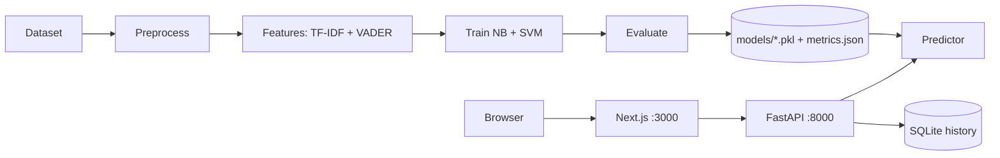
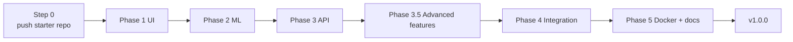

# TruthLens: AI-Based Fake Product Review Detection

TruthLens is an end-to-end web app that tells whether a product review looks **fake or genuine**.
It uses **NLP, TF-IDF, Sentiment Analysis (VADER), Naive Bayes and SVM**, a FastAPI backend and a premium Next.js interface.

> **This README is protected. Nobody edits it.** It is the single source of truth for the whole team.


*(Screenshots appear after Phase 5 is complete.)*

---

## 1. Features

- Single review analyzer: verdict, confidence, sentiment, red flags
- Explainability: highlights the words that pushed the model toward fake or genuine
- Model switch: Naive Bayes, SVM, or Best (auto)
- Batch analysis: upload a CSV, get a summary, filter results, export CSV
- Model Lab: accuracy, precision, recall, F1, ROC-AUC, confusion matrices, ROC curves, TF-IDF vs TF-IDF + sentiment
- History of every analysis (search, filter, delete)
- **Tier-1 rule filter:** instantly flags obvious spam (review flooding, copy-paste floods) before the ML model runs
- **Sarcasm risk flag:** warns when a review opens positive but ends with a strongly negative outcome
- **SHAP explanations:** on-demand explanation of which words pushed the SVM toward fake or genuine
- "How it works" animated pipeline, dark and light theme, responsive

## 2. Tech stack

| Layer | Tools |
|---|---|
| Frontend | Next.js 14+, TypeScript, Tailwind CSS, Framer Motion, Recharts |
| Backend | Python 3.11/3.12, FastAPI, Pydantic v2, SQLAlchemy + SQLite |
| ML / NLP | scikit-learn (TF-IDF, MultinomialNB, SVM), NLTK (VADER, WordNet), imbalanced-learn |
| Testing | pytest, Playwright |
| Packaging | Docker, docker compose |

## 3. Architecture (HLD)



Full diagrams: [`docs/HLD.md`](docs/HLD.md) and [`docs/LLD.md`](docs/LLD.md). Folder tree: [`docs/PROJECT_STRUCTURE.md`](docs/PROJECT_STRUCTURE.md).

**Golden design rule:** training and inference use the exact same `clean_text()`, vectorizer and scaler. The backend imports them from `backend/ml/` and never re-implements them.

---

## 4. TEAM WORKFLOW (5 members, 5 phases, strict order)

Each member completes **one phase**, pushes it to GitHub, and only then does the next member start.
Nobody works in parallel. Nobody skips a phase.

| Member | Phase | Prompt file to give the agent | Result in the repo |
|---|---|---|---|
| 1 | Phase 1: UI (mock mode) | `prompts/phase-1-ui.md` | `frontend/` |
| 2 | Phase 2: ML pipeline | `prompts/phase-2-ml-pipeline.md` | `backend/ml/`, `backend/models/` |
| 3 | Phase 3: Backend API | `prompts/phase-3-backend-api.md` | `backend/app/` |
| 3.5 | Advanced features (project owner, before Phase 4) | `prompts/phase-3.5-advanced-features.md` | Tier-1 filter, sarcasm flag, SHAP |
| 4 | Phase 4: Integration and tests | `prompts/phase-4-integration-testing.md` | e2e tests, fixes, `docs/INTEGRATION_REPORT.md` |
| 5 | Phase 5: Docker, docs, packaging | `prompts/phase-5-docker-docs.md` | Dockerfiles, reports, screenshots |



> **Phase 3.5 (advanced features)** was added by the project owner between Phase 3 and Phase 4. It adds three optional features
> (Tier-1 filter, sarcasm flag, SHAP explanations) without changing the Phase 1-3 behavior. Members 4 and 5 simply pull the latest `main`
> and continue as usual. Details: [`docs/ADVANCED_FEATURES.md`](docs/ADVANCED_FEATURES.md).

### The 8 golden rules

1. **Nobody edits `README.md`.** Also never edit `docs/HLD.md`, `docs/LLD.md`, `docs/PROJECT_STRUCTURE.md`, anything in `prompts/`, `.githooks/`, `scripts/check_phase.py` or `scripts/protected.sha256`. A git hook blocks it and the checker script detects it.
2. **Strict order.** Start your phase only after the previous member has pushed their tag (`phase-N-complete`).
3. **Do only your own phase.** Do not rewrite earlier work. If you find a real problem in an earlier phase, tell that member (or the team) instead of fixing it silently. Phase 4 is the only phase allowed to make small contract fixes.
4. **Always run the checker.** `python scripts/check_phase.py --ready N` before you start, and `python scripts/check_phase.py N` before you push.
5. **Never force-push** (`--force` is forbidden). If a push is rejected, `git pull --rebase origin main`, re-check, push again.
6. **Do not commit** `node_modules`, `.venv`, `.env.local`, `*.db`, or the raw dataset. (They are already in `.gitignore`.)
7. **Work on a branch, then merge to `main`.** Branch names are fixed in each prompt (for example `phase-2-ml`).
8. **Tell the next member** (WhatsApp/Discord) the moment you push.

You can see team progress anytime with:
```bash
git fetch --tags && git tag -l "phase-*"
```

---

## 5. STEP 0: create the repo (Member 1 only, once)

1. Unzip the starter project so you have a `truthlens/` folder.
2. Create an **empty** GitHub repo (no README, no .gitignore, no license), for example `truthlens`.
3. In the `truthlens/` folder:
```bash
git init
git add -A
git update-index --chmod=+x .githooks/pre-commit
git commit -m "chore: starter skeleton"
git branch -M main
git remote add origin https://github.com/<your-username>/truthlens.git
git push -u origin main
git tag starter
git push origin starter
```
4. GitHub, Settings, Collaborators: add the other 4 members with **Write** access.
5. Tell the team the repo URL.

---

## 6. SETUP FOR EVERY MEMBER (do this once on your computer)

Install: **Git**, **Python 3.11 or 3.12**, **Node.js 20+**, and the **Antigravity** IDE. Member 5 also needs **Docker Desktop**.

```bash
git clone https://github.com/<your-username>/truthlens.git
cd truthlens
git config core.hooksPath .githooks        # enables the protection hook (Windows: use Git Bash)

python -m venv .venv
source .venv/bin/activate                  # Windows: .venv\Scripts\activate
pip install -r backend/requirements.txt
python scripts/download_nltk.py
```
Open the **`truthlens/` folder** (the repo root) as the workspace in Antigravity.

> Python packages are **pinned** on purpose. The trained `.pkl` files only load correctly with the same scikit-learn version, so do not upgrade packages.

---

## 7. YOUR PHASE, STEP BY STEP

The same 6 steps apply to every member. Replace `N` with your phase number.

1. **Get the latest code**
   ```bash
   git checkout main
   git pull origin main --tags
   ```
2. **Check that earlier phases are complete**
   ```bash
   python scripts/check_phase.py --ready N
   ```
   If it says NOT READY, stop and tell the previous member. (Phase 1 has no earlier phase.)
3. **Give your phase prompt to the Antigravity agent.** Open `prompts/phase-N-....md`, copy the whole file, paste it into the agent, and let it work. The prompt itself tells the agent to create your branch.
4. **Verify your phase**
   ```bash
   python scripts/check_phase.py N
   ```
   It must print `OK. All checks passed.`
5. **Hand off to GitHub.** The prompt ends with exact git commands (commit, merge into `main`, push, tag `phase-N-complete`). Run them (or let the agent run them) and confirm the push worked.
6. **Message the next member.**

### Phase 1: UI (Member 1)
- Starts from the empty skeleton. Builds the whole Next.js frontend in `frontend/` using **mock data**.
- Done when: `npm run build` passes and all 6 pages work in mock mode, dark and light.

### Phase 2: ML pipeline (Member 2)
- **You must download the dataset first** and place it at `backend/data/raw/reviews.csv` (for example the Deceptive Opinion Spam Corpus, or a Yelp/Amazon fake-review dataset from Kaggle). The dataset is **not** stored in git.
- Trains Naive Bayes and SVM, writes `backend/models/*.pkl` and `metrics.json`. These artifacts **are** committed so later members do not need the dataset.
- Done when: the pipeline ran on the real dataset, every file in `backend/models/` is under 90 MB, tests pass.

### Phase 3: Backend API (Member 3)
- Builds the FastAPI service in `backend/app/` that loads the committed artifacts. No dataset needed.
- Done when: `cd backend && python -m pytest tests -q` passes and every endpoint was tested with curl.

### Phase 3.5: Advanced features (project owner, before Phase 4)
- Adds the Tier-1 filter, the sarcasm flag and SHAP explanations as optional, switchable features. Prompt: `prompts/phase-3.5-advanced-features.md`. Tag: `phase-3.5-complete`.
- Phases 4 and 5 do not need extra setup. Only if you want the SHAP explanations on your machine, see "Advanced features" below.

### Phase 4: Integration and testing (Member 4)
- Switches the frontend from mock to the real API (`NEXT_PUBLIC_USE_MOCK=false`), fixes contract mismatches, adds Playwright end-to-end tests, writes `docs/INTEGRATION_REPORT.md`.
- Also run once: `cd frontend && npx playwright install chromium`.
- Done when: both services run together, e2e tests pass, report is written.

### Phase 5: Docker, docs and packaging (Member 5)
- Adds Dockerfiles and `docker-compose.yml`, generates `docs/MODEL_REPORT.md`, `docs/API.md`, `docs/PRESENTATION_NOTES.md` and the 9 screenshots shown in this README.
- Done when: `docker compose up --build` works and all docs exist. Final tag: `v1.0.0`.

---

## 8. RUNNING THE FINISHED APP

**With Docker (after Phase 5)**
```bash
docker compose up --build
```
Open http://localhost:3000 (API docs at http://localhost:8000/docs).

**Without Docker (two terminals)**
```bash
# terminal 1
cd backend && uvicorn app.main:app --reload --port 8000
# terminal 2
cd frontend && npm install && npm run dev
```
Make sure `frontend/.env.local` contains:
```
NEXT_PUBLIC_API_URL=http://localhost:8000
NEXT_PUBLIC_USE_MOCK=false
```

**Retrain the models (needs the dataset)**
```bash
cd backend && python -m ml.run_pipeline
```

## 8.1 ADVANCED FEATURES (Phase 3.5, optional)

| Feature | What it does | Switch (environment variable, default on) |
|---|---|---|
| Tier-1 rule filter | Hard rules (more than 5 reviews per minute from one user, the same text repeated 3+ times) flag spam instantly and skip the ML model. Soft signals (very short text, links, repeated characters) are reported but never change the verdict. | `ENABLE_TIER1` |
| Sarcasm flag | Positive opening plus strong negative outcome raises `SARCASM_SUSPECTED` (needs human review). It never changes the fake verdict. | `ENABLE_SARCASM` |
| SHAP explanations | `POST /api/explain` returns the words that pushed the SVM toward fake or genuine. Naive Bayes uses a log-probability explanation. | `ENABLE_SHAP` |

Turn a feature off by setting its variable to `false` before starting the backend. With all three off, `/api/predict` behaves exactly as in Phase 3.

Optional SHAP install (the app works without it, using coefficient scores instead):
```bash
pip install -r backend/requirements-advanced.txt -c backend/constraints-advanced.txt
```
The constraints file keeps numpy and scikit-learn at their pinned versions. Full details, examples and limitations: [`docs/ADVANCED_FEATURES.md`](docs/ADVANCED_FEATURES.md).

---

## 9. API SUMMARY

| Method | Path | Purpose |
|---|---|---|
| POST | `/api/predict` | Analyze one review |
| POST | `/api/predict/batch` | Analyze a CSV (max 5000 rows) |
| POST | `/api/explain` | Word-level explanation (SHAP for SVM) for one review |
| GET | `/api/models` | Available models |
| GET | `/api/models/metrics` | Training metrics (`metrics.json`) |
| GET | `/api/history` | List past analyses |
| DELETE | `/api/history/{id}` | Delete one |
| DELETE | `/api/history` | Clear all |
| GET | `/api/health` | Service status |

Request and response shapes are defined in [`docs/LLD.md`](docs/LLD.md). Real examples are in `docs/API.md` (Phase 5).

## 10. HELPFUL COMMANDS

| Command | What it does |
|---|---|
| `python scripts/check_phase.py --ready N` | Are all phases before N complete? Run before you start. |
| `python scripts/check_phase.py N` | Is phase N complete? Run before you push. |
| `make setup` / `make test` / `make train` | Shortcuts (Mac/Linux, or Windows with make installed) |
| `git tag -l "phase-*"` | See which phases are finished |

## 11. TROUBLESHOOTING

| Problem | Fix |
|---|---|
| `check_phase.py` says a protected file was modified | `git checkout origin/main -- <file>` to restore it |
| Commit blocked: "protected files" | You edited a protected file. Undo with `git restore --staged --worktree -- <file>` |
| `--ready` says tag not found | `git pull origin main --tags` |
| Push rejected | `git pull --rebase origin main`, run the check again, push. Never `--force`. |
| `LookupError: vader_lexicon / wordnet` | `python scripts/download_nltk.py` |
| Model file fails to load | You have different package versions. Reinstall with `pip install -r backend/requirements.txt` |
| CORS error in browser | Backend `CORS_ORIGINS` must include `http://localhost:3000` |
| Port already in use | Stop the other process or change the port |
| A `.pkl` file is over 100 MB | Phase 2 must shrink it (fewer TF-IDF features, linear SVM) before pushing |

## 12. LIMITATIONS AND FUTURE WORK

**What the advanced features address (and what they do not)**

| Problem | What was added | Status |
|---|---|---|
| Scalability: running the ML model on obvious spam wastes compute | Tier-1 rule filter skips the model for hard-rule spam (review flooding, repeated text) | Partially addressed. The rules are heuristics. No load test and no accuracy was measured. |
| Context blindness: sarcastic reviews (positive opening, negative outcome) | Sarcasm risk flag `SARCASM_SUSPECTED` | Partially addressed. It is a flag for human review, not a verdict. Accuracy not measured, keyword lists are small. |
| Explainability: why did the model say fake? | Token highlighting plus on-demand SHAP explanations | Addressed for the SVM. Naive Bayes uses a log-probability explanation. |
| Hinglish / multilingual reviews | Nothing | **Not addressed.** The classifier is English only. |
| Reviews written by LLMs (GPT-style text) | Nothing | **Not addressed.** |
| Domain shift (trained on hotel reviews, used on products) | Nothing | **Not addressed.** A product-review training set is needed. |

**Limitations (honest list)**
- The classifier is trained on the Deceptive Opinion Spam Corpus (about 1,600 English **hotel** reviews). Results on other product domains can be much worse, and out-of-domain text may be labelled fake too often.
- **English only.** Hindi and Hinglish text is not supported by the classifier. The few Hindi/Hinglish words in the sarcasm lists are plain keyword matches, not language understanding.
- The Tier-1 filter and the sarcasm flag are **heuristics**. Their accuracy was not measured on a labelled dataset, so no accuracy is claimed. Sarcasm is a risk flag, not a fake verdict.
- Tier-1 velocity and duplicate tracking is kept in memory per server process and resets on restart. It needs a shared store (for example Redis) to work across several server processes.
- SHAP explains the linear SVM only; for a linear model it equals the coefficient times the TF-IDF value. Naive Bayes uses a log-probability explanation.
- The model detects text patterns, not whether the reviewer actually bought the product. Star rating is not a model feature.
- Not implemented: LLM-generated text detection (for example perplexity or burstiness with a language model) and transformer-based multilingual models.

**Future work**
- Fine-tune a multilingual transformer (for example MuRIL or XLM-RoBERTa) on a labelled Hinglish review set.
- Add a labelled evaluation set for the Tier-1 and sarcasm heuristics so their precision and recall can be measured.
- Reviewer behavior features (account age, posting history) and a shared store for velocity tracking.
- Detection of machine-generated reviews, trained on a labelled LLM-vs-human review set.
- A browser extension and a larger, multi-domain training set.
