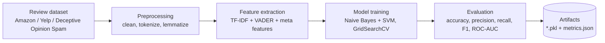
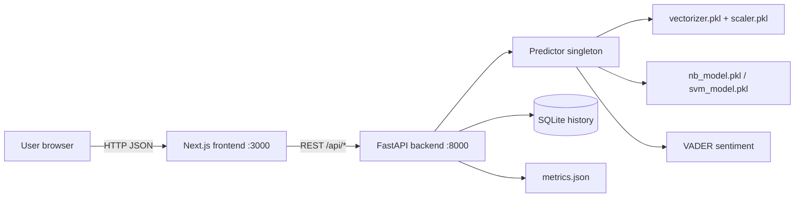
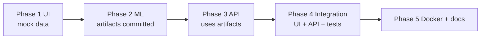
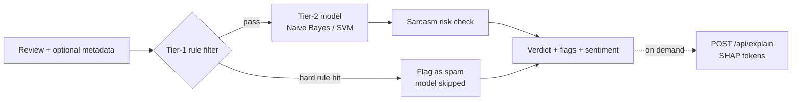

# High-Level Design (HLD)

## 1. System flow (training time)

## 2. Runtime architecture (prediction time)

## 3. Components

| Component | Responsibility | Built in |
|---|---|---|
| Frontend (Next.js) | Premium UI: analyzer, batch, model lab, history, how it works | Phase 1 |
| ML pipeline (`backend/ml`) | Preprocess, features, train NB and SVM, evaluate, save artifacts | Phase 2 |
| Backend API (`backend/app`) | Serve predictions, explanations, history, metrics | Phase 3 |
| Integration | Connect frontend to real API, end-to-end tests, bug fixing | Phase 4 |
| Packaging | Docker, reports, screenshots, presentation notes | Phase 5 |

## 4. Golden design rule

Training and inference MUST use the exact same `clean_text()` and the exact same fitted vectorizer and scaler.
The backend imports them from `backend/ml/`. It never re-implements them.

## 5. Phase dependency chain

## 6. Prediction pipeline with Phase 3.5 features

Each of the three additions (Tier-1, sarcasm, SHAP) can be switched off with an environment variable (`ENABLE_TIER1`, `ENABLE_SARCASM`, `ENABLE_SHAP`).
