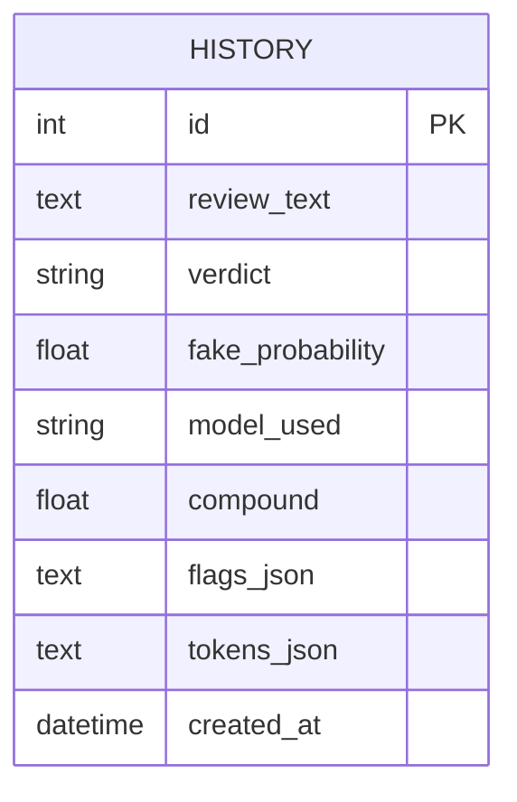
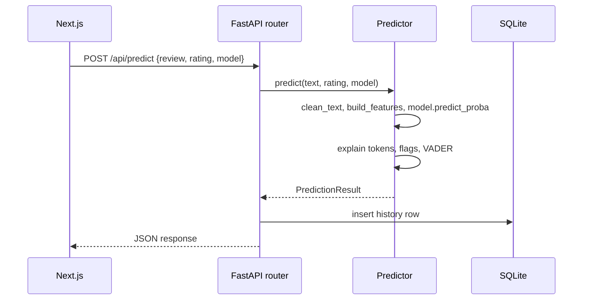

# Low-Level Design (LLD)

## 1. ML modules (`backend/ml/`)

| File | Responsibility |
|---|---|
| `config.py` | Paths, `FAKE_LABEL = 1`, `COLUMN_MAP`, `LABEL_MAP`, `RANDOM_STATE` |
| `preprocess.py` | `clean_text(text)`, `load_dataset(path)` |
| `features.py` | TF-IDF (1-2 grams), VADER, meta features, scaler, `build_features(...)` |
| `train_nb.py` | Multinomial NB, GridSearchCV on alpha |
| `train_svm.py` | SVM (linear/rbf) tuned on C, gamma, wrapped in `CalibratedClassifierCV` |
| `evaluate.py` | Metrics, confusion matrix, ROC, best-model selection, writes `metrics.json` |
| `run_pipeline.py` | One command: `python -m ml.run_pipeline` |

Artifacts written to `backend/models/`: `vectorizer.pkl`, `scaler.pkl`, `nb_model.pkl`, `svm_model.pkl`, `svm_linear_base.pkl`, `metrics.json`.

### metrics.json contract

```json
{
  "generated_at": "ISO-8601",
  "dataset": { "name": "", "size": 0, "train_size": 0, "test_size": 0, "fake_percent": 0.0, "avg_words": 0.0 },
  "best_model": "nb | svm",
  "active_feature_set": "tfidf_only | tfidf_sentiment",
  "models": {
    "nb":  { "tfidf_only": { "accuracy": 0, "precision": 0, "recall": 0, "f1": 0, "roc_auc": 0,
                              "confusion_matrix": [[0,0],[0,0]], "roc_curve": {"fpr": [], "tpr": []}, "best_params": {} },
             "tfidf_sentiment": { "...": "same keys" } },
    "svm": { "tfidf_only": { "...": "same keys" }, "tfidf_sentiment": { "...": "same keys" } }
  }
}
```
Confusion matrix layout is `[[TN, FP], [FN, TP]]`, where "positive" means fake. Floats rounded to 4 decimals.

## 2. Backend modules (`backend/app/`)

| File | Responsibility |
|---|---|
| `main.py` | FastAPI app, CORS, lifespan (load models once) |
| `config.py` | Paths, limits, `CORS_ORIGINS`, `DATABASE_URL` |
| `schemas.py` | Pydantic request/response models |
| `routers/predict.py` | `/api/predict`, `/api/predict/batch` |
| `routers/models.py` | `/api/models`, `/api/models/metrics` |
| `routers/history.py` | history list, delete, clear |
| `routers/health.py` | `/api/health` |
| `services/predictor.py` | Singleton: load artifacts, predict, probability |
| `services/explain.py` | Top contributing tokens (NB log-prob diff, SVM coefficients) |
| `services/flags.py` | Rule-based red flags |
| `services/sentiment.py` | VADER scores and label |
| `db/` | SQLAlchemy engine and `history` table |

## 3. API contract

| Method | Path | Purpose |
|---|---|---|
| POST | `/api/predict` | Analyze one review |
| POST | `/api/predict/batch` | Analyze a CSV (max 5000 rows, 5 MB); `?format=csv` returns a CSV |
| GET | `/api/models` | Available models and default |
| GET | `/api/models/metrics` | Contents of `metrics.json` |
| GET | `/api/history` | List with `search`, `verdict`, `limit`, `offset` |
| DELETE | `/api/history/{id}` | Delete one entry |
| DELETE | `/api/history` | Clear all |
| GET | `/api/health` | `{status, models_loaded, version}` |

`POST /api/predict` request: `{ "review": "...", "rating": 1-5 (optional), "model": "best | nb | svm" }`

Response:
```json
{
  "id": 1, "verdict": "fake | genuine", "fake_probability": 0.87, "confidence": 0.87,
  "model_used": "svm",
  "sentiment": { "compound": 0.92, "label": "Positive | Mixed | Negative", "pos": 0.6, "neu": 0.4, "neg": 0.0 },
  "flags": [{ "code": "ALL_CAPS", "label": "Words in ALL CAPS", "severity": "low | medium | high" }],
  "tokens": [{ "token": "amazing", "score": 1.42, "direction": "fake | genuine" }],
  "meta": { "words": 14, "exclamations": 7, "caps_words": 3 },
  "latency_ms": 18, "created_at": "ISO-8601"
}
```
Errors always: `{ "error": { "code": "string", "message": "string" } }`.

## 4. Database



## 5. Sequence: POST /api/predict



## 6. Frontend component tree (`frontend/src/`)

```
app/            layout, page (landing), analyze, batch, model-lab, history, how-it-works
components/
  ui/           restyled primitives
  layout/       Navbar, Footer, ThemeToggle, StatusChip, CommandPalette
  analyzer/     ReviewInput, VerdictCard, ConfidenceGauge, HighlightedText,
                SentimentMeter, FlagList, ModelSwitch, TopTokens
  batch/        DropZone, ResultsTable, SummaryStats
  lab/          MetricCards, ConfusionMatrix, RocChart, ComparisonBars
  history/      HistoryList, HistoryFilters
lib/            api.ts (real client + switch), mockApi.ts, types.ts, utils.ts
```

## 7. Phase 3.5 additions (optional fields, backward compatible)

All additions are optional. With `ENABLE_TIER1`, `ENABLE_SARCASM` and `ENABLE_SHAP` set to `false`, `/api/predict` returns exactly the Phase 3 shape.

### Request: new optional field on `POST /api/predict`
```json
"metadata": { "user_id": "string?", "posted_at": "ISO-8601?", "reviews_last_minute": 0 }
```

### Response: new optional fields on `POST /api/predict`
```json
{
  "tier1": {
    "triggered": false,
    "action": "pass | flag_spam",
    "rules": [{ "code": "VERY_SHORT", "label": "...", "severity": "low | medium | high", "kind": "soft | hard" }]
  },
  "decision_source": "model | tier1_rules",
  "sarcasm": { "suspected": true, "score": 0.82, "risk_level": "high", "positive_cues": ["wow"], "negative_cues": ["garbage"] }
}
```
- Hard Tier-1 rules (`VELOCITY_EXCEEDED`, `DUPLICATE_FLOOD`) skip the model: `verdict = "fake"`, `model_used = "tier1_rules"`, `decision_source = "tier1_rules"`. The probability then is a rule decision, not a model score.
- Soft Tier-1 signals appear only inside `tier1.rules`, never in the existing `flags` list.
- Sarcasm never changes `verdict` or `fake_probability`. When suspected it adds the flag `SARCASM_SUSPECTED` (severity high) to `flags`.
- `model_used` may now also be `"tier1_rules"`.

### Batch: optional CSV columns `user_id`, `posted_at`; `summary.tier1_flagged` is added when Tier-1 is enabled.

### New endpoint: `POST /api/explain`
Request: `{ "review": "string (1-5000)", "model": "best | nb | svm" }`
```json
{
  "method": "shap-linear | naive-bayes-logprob | linear-coefficients",
  "model_used": "svm",
  "base_value": 0.0,
  "tokens": [{ "token": "amaze", "score": 0.1889, "direction": "fake | genuine" }],
  "token_map": { "amaze": ["AMAZING"] },
  "latency_ms": 12
}
```
`linear-coefficients` is the fallback when the optional `shap` package is not installed.

### New modules
| File | Responsibility |
|---|---|
| `backend/app/services/tier1.py` | Hard and soft spam rules, in-memory sliding windows |
| `backend/app/services/sarcasm.py` | Sentiment-contrast sarcasm score |
| `backend/app/services/explain_shap.py` | SHAP (linear) explanation, lazy import of `shap` |
| `backend/app/routers/explain.py` | `POST /api/explain` |
